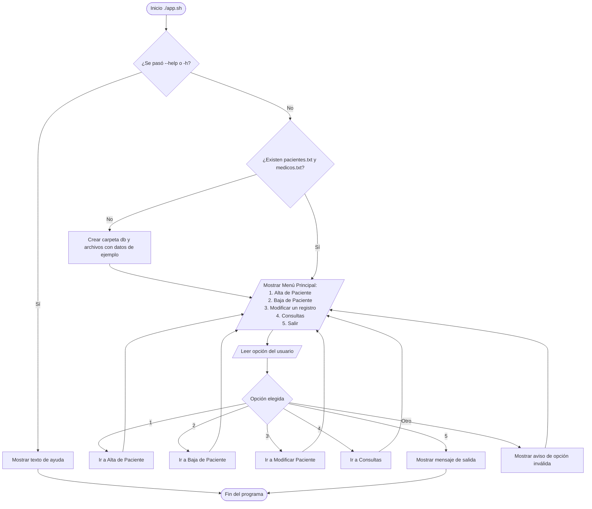
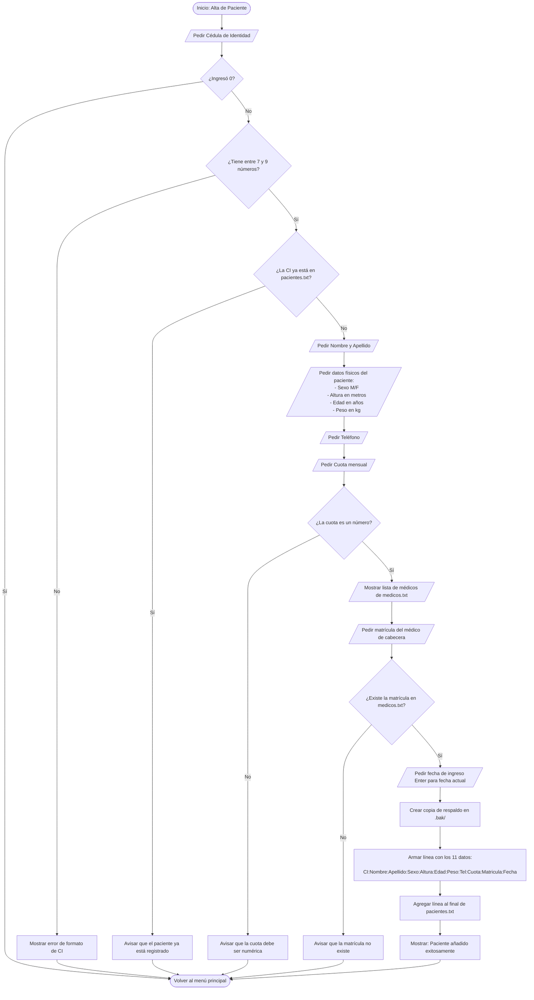
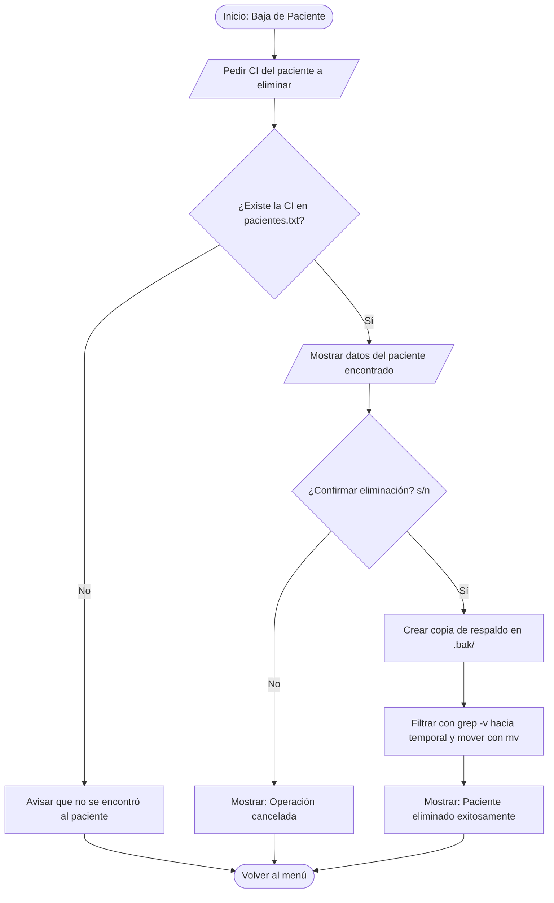
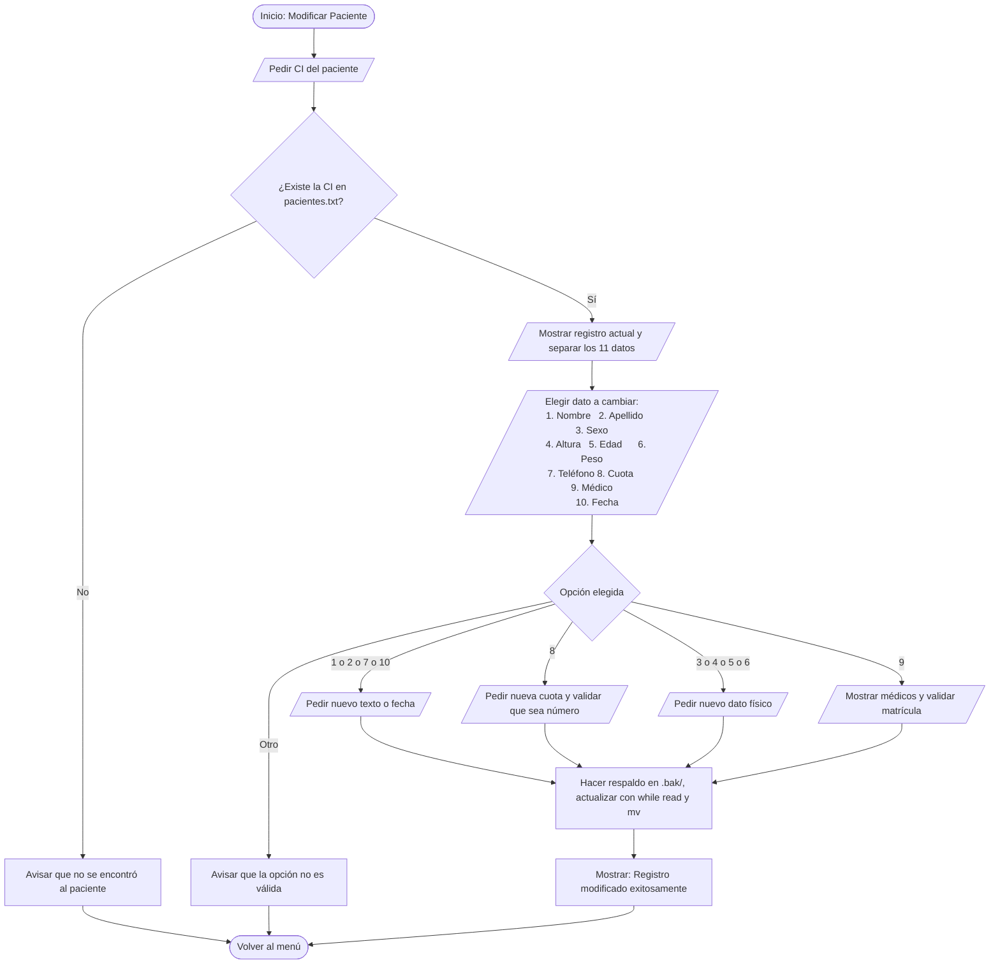

# Diagramas de Flujo del Programa

Diagramas en formato Mermaid que muestran paso a paso cómo funciona cada opción del script `app.sh`.

---

## 1. Menú Principal y Arranque

---

## 2. Alta de Paciente

Los datos se piden en tres partes ordenadas: primero los datos del usuario (personales y físicos), luego el médico de cabecera y por último la fecha de ingreso.

---

## 3. Baja de Paciente

---

## 4. Modificar un Registro

---

## 5. Submenú de Consultas (10 Opciones)

```mermaid
flowchart TD
    InicioCons([Inicio: Consultas]) --> MenuConsultas[/Mostrar las 10 opciones de consulta:
    1. Pacientes de un médico
    2. Cuota de un socio
    3. Médico de un paciente
    4. Total mensual de ingresos
    5. Cantidad de pacientes por médico
    6. Mostrar todos o buscar por CI
    7. Consultar por sexo
    8. Consultar por edad
    9. Consultar por altura
    10. Consultar por peso/]
    
    MenuConsultas --> LeerCons[/Leer opción/]
    LeerCons --> SwitchCons{Opción}
    
    %% Consulta 1
    SwitchCons -- 1 --> C1PedirMed[/Pedir matrícula del médico/]
    C1PedirMed --> C1Filtrar[Recorrer pacientes.txt y comparar matrícula]
    C1Filtrar --> C1Mostrar[/Mostrar nombre y apellido de sus pacientes/]
    C1Mostrar --> FinCons([Volver al menú principal])
    
    %% Consulta 2
    SwitchCons -- 2 --> C2PedirCI[/Pedir CI del socio/]
    C2PedirCI --> C2BuscarCI{"¿Existe la CI?"}
    C2BuscarCI -- Sí --> C2Mostrar[/Mostrar nombre y valor de su cuota/]
    C2BuscarCI -- No --> C2Err[Avisar que no se encontró al socio]
    C2Mostrar --> FinCons
    C2Err --> FinCons
    
    %% Consulta 3
    SwitchCons -- 3 --> C3PedirCI[/Pedir CI del paciente/]
    C3PedirCI --> C3BuscarCI{"¿Existe la CI?"}
    C3BuscarCI -- Sí --> C3Mostrar[/Buscar médico en medicos.txt y mostrar su nombre/]
    C3BuscarCI -- No --> C3Err[Avisar que no se encontró al paciente]
    C3Mostrar --> FinCons
    C3Err --> FinCons
    
    %% Consulta 4
    SwitchCons -- 4 --> C4Sumar[Sumar las cuotas de todos los pacientes]
    C4Sumar --> C4Mostrar[/Mostrar el ingreso mensual total/]
    C4Mostrar --> FinCons
    
    %% Consulta 5
    SwitchCons -- 5 --> C5Contar[Contar cuántos pacientes tiene cada médico]
    C5Contar --> C5Mostrar[/Mostrar lista de médicos con su cantidad/]
    C5Mostrar --> FinCons
    
    %% Consulta 6
    SwitchCons -- 6 --> C6Sub[/1: Mostrar todos  2: Buscar por CI/]
    C6Sub -- 1 --> C6Todos[/Mostrar todo el archivo/]
    C6Sub -- 2 --> C6Ficha[/Mostrar ficha completa del paciente/]
    C6Todos --> FinCons
    C6Ficha --> FinCons
    
    %% Consulta 7
    SwitchCons -- 7 --> C7Pedir[/Pedir sexo M o F/]
    C7Pedir --> C7Filtrar[Filtrar pacientes con ese sexo]
    C7Filtrar --> C7Mostrar[/Mostrar pacientes y total encontrados/]
    C7Mostrar --> FinCons
    
    %% Consulta 8
    SwitchCons -- 8 --> C8Pedir[/Pedir edad exacta ej: 35 o rango ej: 20-40/]
    C8Pedir --> C8Filtrar[Filtrar pacientes por edad]
    C8Filtrar --> C8Mostrar[/Mostrar pacientes que coinciden/]
    C8Mostrar --> FinCons
    
    %% Consulta 9
    SwitchCons -- 9 --> C9Pedir[/Pedir altura en metros ej: 1.75/]
    C9Pedir --> C9Filtrar[Filtrar pacientes por altura]
    C9Filtrar --> C9Mostrar[/Mostrar pacientes que coinciden/]
    C9Mostrar --> FinCons
    
    %% Consulta 10
    SwitchCons -- 10 --> C10Pedir[/Pedir peso en kg ej: 75 o rango ej: 60-80/]
    C10Pedir --> C10Filtrar[Filtrar pacientes por peso]
    C10Filtrar --> C10Mostrar[/Mostrar pacientes que coinciden/]
    C10Mostrar --> FinCons
    
    SwitchCons -- Otro --> ErrCons[Mostrar: Opción no válida]
    ErrCons --> FinCons
```

