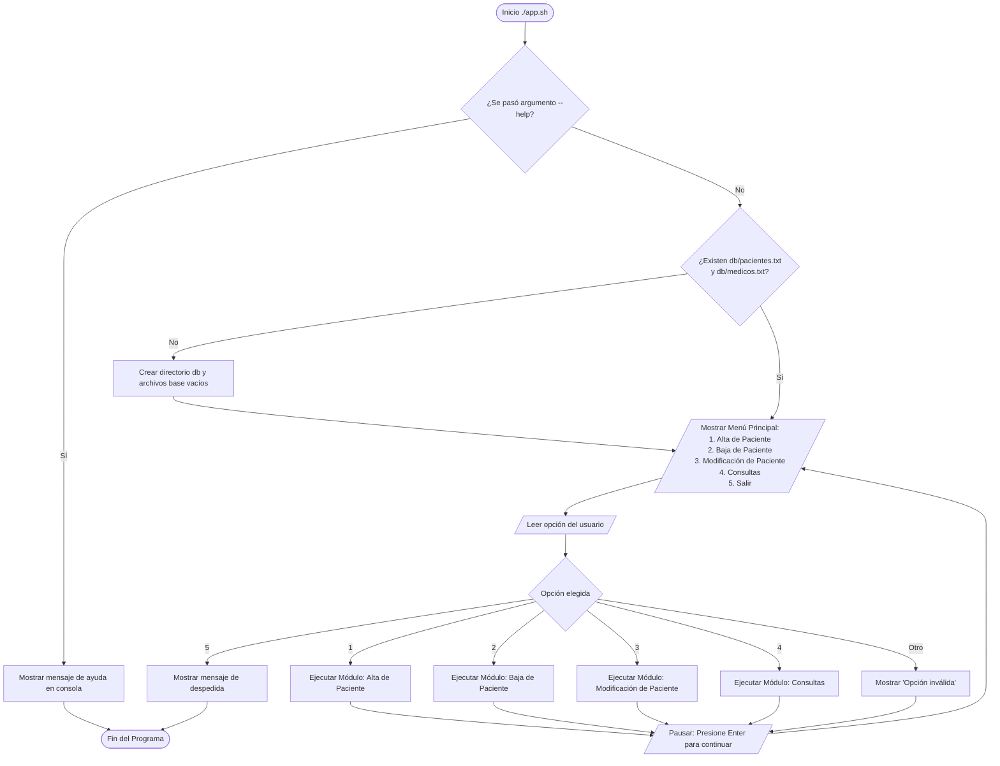
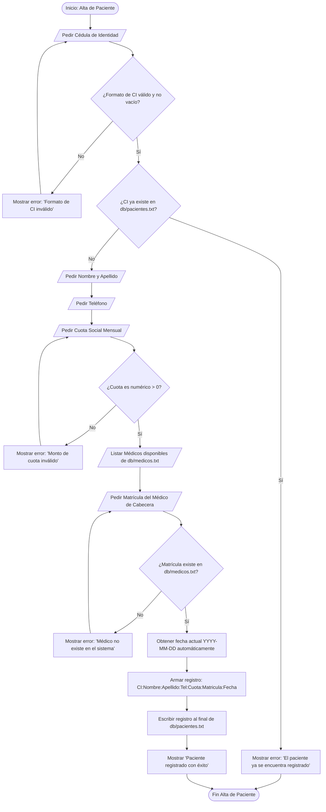
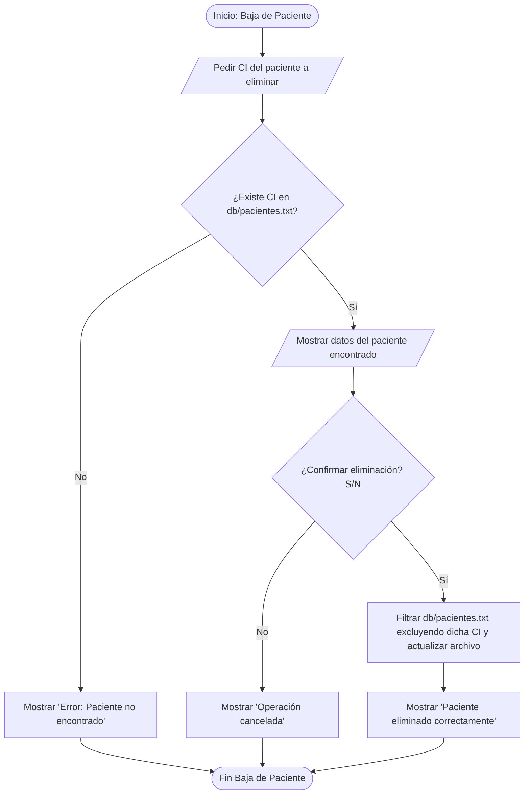
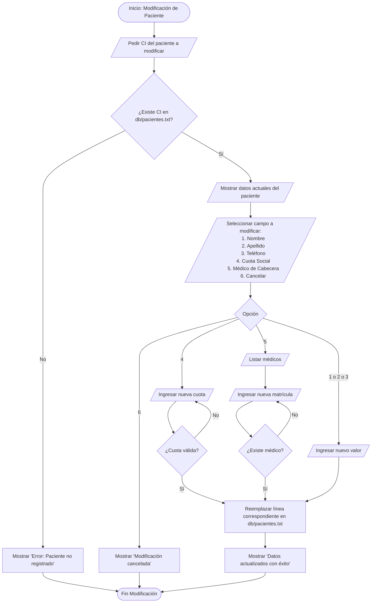
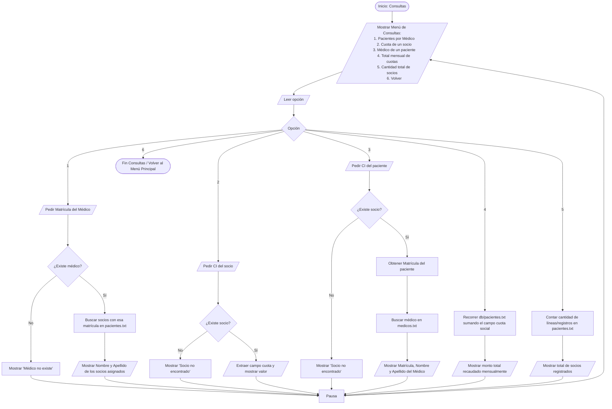

# Diagramas de Flujo del Sistema de Mutualista

A continuación se presentan los diagramas de flujo completos del sistema en formato Mermaid, listos para visualizar o exportar a herramientas como draw.io, Mermaid Live Editor, Markdown o PDF.

---

## 1. Menú Principal y Flujo General

---

## 2. Proceso: Alta de Paciente

---

## 3. Proceso: Baja de Paciente

---

## 4. Proceso: Modificación de Paciente

---

## 5. Proceso: Submenú de Consultas

